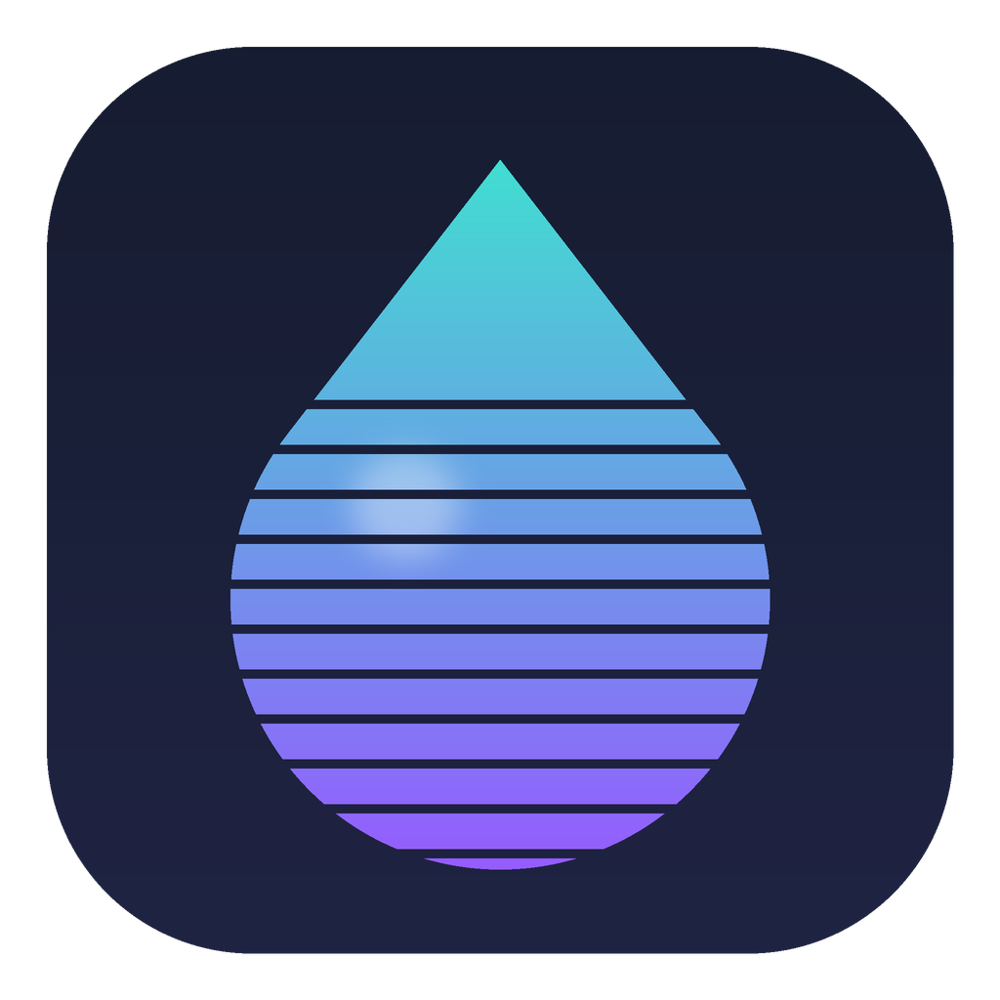
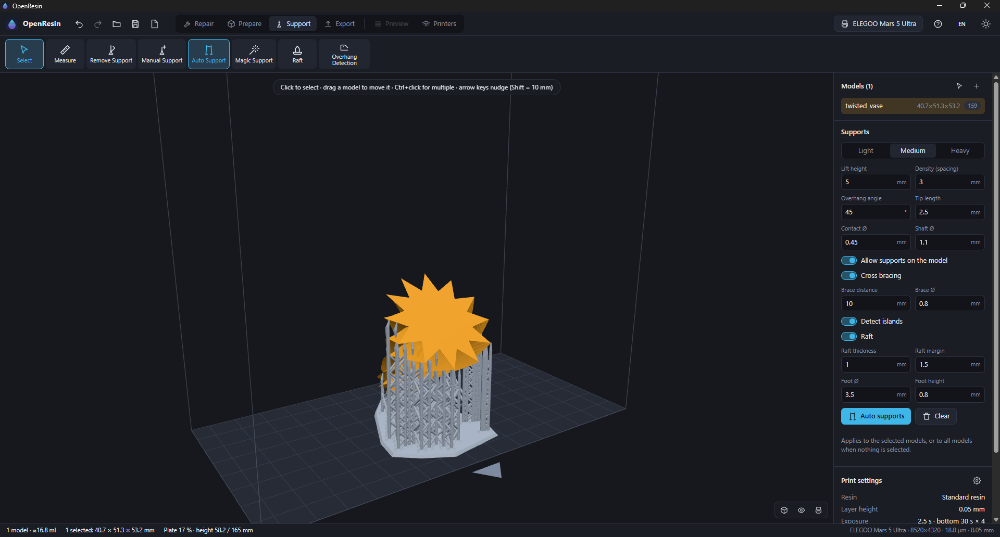
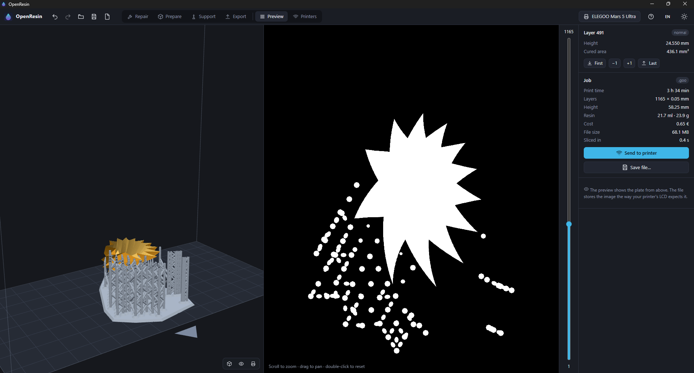

<a id="readme-top"></a>

<div align="center">



# OpenResin

**Privacy-friendly open-source slicer and printer manager for MSLA resin printers.**

Prepare, support and slice models, then send them to your printer, manage its
files and watch its camera – on Windows, macOS and Linux, fully offline.

<!-- status -->
[](https://github.com/MikaGroenewold/OpenResin/actions/workflows/ci.yml)
[](https://github.com/MikaGroenewold/OpenResin/releases)
[](https://github.com/MikaGroenewold/OpenResin/releases)
[](LICENSE)
[](#install)

<!-- community -->
[](https://github.com/MikaGroenewold/OpenResin/stargazers)
[](https://github.com/MikaGroenewold/OpenResin/forks)
[](https://github.com/MikaGroenewold/OpenResin/watchers)
[](https://github.com/MikaGroenewold/OpenResin/issues)
[](https://github.com/MikaGroenewold/OpenResin/pulls)
[](https://github.com/MikaGroenewold/OpenResin/graphs/contributors)
[](https://github.com/MikaGroenewold/OpenResin/commits/main)

<!-- built with -->
[](https://www.rust-lang.org)
[](https://tauri.app)
[](https://react.dev)
[](https://www.typescriptlang.org)
[](https://threejs.org)

[**Download**](#install) ·
[**Features**](#features) ·
[**Build from source**](#build-from-source) ·
[**Report a bug**](https://github.com/MikaGroenewold/OpenResin/issues/new?template=bug_report.yml) ·
[**Request a feature**](https://github.com/MikaGroenewold/OpenResin/issues/new?template=feature_request.yml)

</div>

<p align="center">
  
</p>

<details>
<summary><strong>More screenshots</strong></summary>

<p align="center">
  
</p>

</details>

> [!IMPORTANT]
> **No account, no cloud, no telemetry.** OpenResin only talks to the
> printers on your own network that you connect to. It never contacts the
> internet – not even for update checks.

If OpenResin is useful to you, please consider giving it a ⭐ – it helps other
resin printer owners find the project.

OpenResin is an independent project. It is not affiliated with or endorsed by
CBD Technology (CHITUBOX), ELEGOO, Anycubic, Creality or any other vendor; all
product names are trademarks of their owners and are used only to describe
compatibility.

<details>
<summary><strong>Table of contents</strong></summary>

- [Features](#features)
- [Supported printers and file formats](#supported-printers-and-file-formats)
- [Install](#install)
- [Build from source](#build-from-source)
- [Command line](#command-line)
- [Tests](#tests)
- [Project layout](#project-layout)
- [Contributing](#contributing)
- [Security](#security)
- [Star history](#star-history)
- [License](#license)

</details>

## Features

The workflow follows the familiar **Repair → Prepare → Support → Export**
ribbon, so switching from other resin slicers is easy.

### Prepare

- Import STL (binary/ASCII), OBJ and 3MF (including multi-part 3MF), by
  drag & drop, from the file manager or from the command line.
- Drag models directly on the plate; move/rotate/scale gizmos; exact numeric
  position, rotation and size; arrow-key nudging.
- **Auto orient** with a goal: balanced, fewest supports or lowest height.
- **Lay flat** on a clicked face, **auto layout**, copies and **fill plate**,
  mirror, align, combine.
- **Split** into parts, **cut** along X/Y/Z with capped faces, **hollow** with
  drain holes, **boolean subtract** (any model can be a cutter).
- Raised or engraved **text labels**, a solid **platform** under a model, and
  a measure tool.

### Repair

- Detects holes, open and non-manifold edges, flipped normals, inverted parts
  and duplicate triangles, and repairs them in one click.

### Supports

- **Automatic supports** from overhang sampling plus island detection, and a
  dense "magic" mode.
- Manual add/remove; light, medium and heavy tips; raft with chamfer.
- **Cross bracing** between tall pillars, supports on the model, overhang
  highlighting; supports follow X/Y mirroring.

### Slice and preview

- Fast parallel scanline rasterizer with exact anti-aliasing (2–16×).
- Correct handling of overlapping and nested meshes and of subtracted volumes.
- Per-printer LCD mirroring that matches the reference slicer pixel for pixel.
- Print time, resin volume, weight and cost; resin presets.
- 2D layer preview with zoom/pan next to the 3D model cut at the current layer.

### Printers on your network

- **Discovery** by UDP broadcast, or add printers by IP; saved printers
  reconnect automatically.
- **Live status**: progress, layer, elapsed/remaining time, finish time,
  temperatures and storage; pause/resume/stop; notifications when a print
  finishes or fails.
- **Remote file manager**: internal storage and USB, folders, search,
  thumbnails, multi-select, print, download, delete, and an upload queue with
  drag & drop.
- Print history, time-lapse toggle, rename printer.
- **Camera**: live view and snapshots. RTSP/H.264 is decoded locally and shown
  as MJPEG – no FFmpeg needed.
- **Slice & send** in one click.

### Everything else

Undo/redo, project files (`.orproj`), English and German interface,
light/dark theme, keyboard shortcuts (press <kbd>F1</kbd>), first-run setup.

## Supported printers and file formats

**193 printer profiles** are built in – ELEGOO, Anycubic, Phrozen, EPAX,
Creality, Carima, Nova3D, Peopoly, QIDI, Uniformation, Wanhao, Flashforge,
Voxelab and more. Custom printers can be added in the app.

**27 output formats:**

| Vendor | Formats |
| --- | --- |
| ELEGOO | `goo` |
| CHITUBOX-based printers | classic `ctb` (v3) |
| Anycubic Photon Workshop | `pwmx`, `pwma`, `pwmb`, `pwmo`, `pwms`, `pmsq`, `pm3`, `pm3m`, `pm3n`, `pm3r`, `px6s`, `pm4n`, `pm5`, `pm5s`, `dlp`, … |
| Creality | `cxdlp`, `cxdlpv4` |
| Prusa | `sl1` |
| Generic | PNG zip with G-code |

Encrypted CTB files (as written by recent CHITUBOX versions) are not
supported, because that would require vendor keys.

**Network protocols:**

| Protocol | Printers | Status |
| --- | --- | --- |
| SDCP V3 | ELEGOO Saturn 3/4 Ultra, Mars 4/5 Ultra and other SDCP boards | full support, tested on a Mars 5 Ultra |
| SDCP < V3 | early Saturn 3 Ultra / Mars 4 Ultra firmware | implemented, untested |
| Legacy Chitu WiFi (UDP) | many CTB printers with Chitu WiFi boards | experimental |
| Creality HALOT, Anycubic LAN | – | not supported yet |

See [docs/protocols](docs/protocols/README.md) for the protocol notes.

## Install

CI builds installers for Windows (`.msi`, `.exe`), macOS (`.dmg`, Apple
Silicon and Intel) and Linux (`.AppImage`, `.deb`, `.rpm`) on every push –
download them from the artifacts of the latest
[CI run](https://github.com/MikaGroenewold/OpenResin/actions/workflows/ci.yml).
Tagged versions are published on the
[releases page](https://github.com/MikaGroenewold/OpenResin/releases).

## Build from source

You need [Rust](https://rustup.rs) (stable, 1.85 or newer) and
[Node.js](https://nodejs.org) 20 or newer.

```bash
git clone https://github.com/MikaGroenewold/OpenResin.git
cd OpenResin/app
npm ci
npm run tauri dev      # run in development mode
npm run tauri build    # create installers in target/release/bundle
```

Platform requirements:

- **Windows:** Visual Studio C++ build tools; WebView2 ships with Windows 10/11.
- **macOS:** Xcode command line tools.
- **Linux:** the webview libraries:

  ```bash
  # Debian/Ubuntu
  sudo apt install libwebkit2gtk-4.1-dev libappindicator3-dev librsvg2-dev patchelf
  # Fedora
  sudo dnf install webkit2gtk4.1-devel libappindicator-gtk3-devel librsvg2-devel
  # Arch
  sudo pacman -S webkit2gtk-4.1 libappindicator-gtk3 librsvg
  ```

## Command line

The `openresin` CLI slices and controls printers without the GUI:

```bash
cargo run --release -p openresin-cli -- printers saturn
cargo run --release -p openresin-cli -- slice model.stl -p elegoo-saturn-4-ultra --supports -o model.goo
cargo run --release -p openresin-cli -- discover
cargo run --release -p openresin-cli -- status 192.168.1.50
cargo run --release -p openresin-cli -- upload 192.168.1.50 model.goo --print
cargo run --release -p openresin-cli -- camera 192.168.1.50 --snapshot cam.jpg
```

## Tests

The features are covered by tests that check real results: pixel areas of
sliced layers, files written and read back in every format, the exact
messages sent to simulated printers, and the frontend's calls to the backend.
Network tests only use simulated printers on `127.0.0.1`.

```bash
cargo test --workspace --exclude openresin-app   # core, formats, network, CLI
cargo test -p openresin-app                      # desktop app commands
cd app && npm test                               # frontend
```

## Project layout

| Path | Contents |
| --- | --- |
| `crates/core` | meshes, STL/OBJ/3MF import, scene, slicer/rasterizer, supports, repair, hollow, cut, orient, labels, estimates, projects |
| `crates/formats` | printer file writers/readers and the parallel export pipeline |
| `crates/net` | discovery, SDCP and legacy Chitu clients, file transfer, RTSP/MJPEG camera relay |
| `crates/cli` | `openresin` command line tool |
| `app` | desktop application (Tauri 2 + React + three.js) |
| `profiles/printers.json` | built-in printer database (machine facts only) |
| `docs/protocols` | network protocol notes |

## Contributing

Issues and pull requests are welcome – especially test reports from printers
and file formats that have not been verified on real hardware yet (see the
status tables above). Please read [CONTRIBUTING.md](CONTRIBUTING.md) and run
the tests before opening a pull request. Everyone taking part is expected to
follow the [code of conduct](CODE_OF_CONDUCT.md).

- 🐞 [Report a bug](https://github.com/MikaGroenewold/OpenResin/issues/new?template=bug_report.yml)
- 🖨️ [Report printer or file format compatibility](https://github.com/MikaGroenewold/OpenResin/issues/new?template=printer_report.yml)
- 💡 [Request a feature](https://github.com/MikaGroenewold/OpenResin/issues/new?template=feature_request.yml)

<a href="https://github.com/MikaGroenewold/OpenResin/graphs/contributors">
  
</a>

## Security

Please do not report security problems in public issues. See
[SECURITY.md](SECURITY.md) for how to report them privately.

## Star history

<a href="https://star-history.com/#MikaGroenewold/OpenResin&Date">
  <picture>
    <source media="(prefers-color-scheme: dark)" srcset="https://api.star-history.com/svg?repos=MikaGroenewold/OpenResin&type=Date&theme=dark">
    <source media="(prefers-color-scheme: light)" srcset="https://api.star-history.com/svg?repos=MikaGroenewold/OpenResin&type=Date">
    
  </picture>
</a>

## License

OpenResin is free software: you can redistribute it and/or modify it under the
terms of the GNU General Public License as published by the Free Software
Foundation, either version 3 of the License, or (at your option) any later
version. See [LICENSE](LICENSE) for the full text.

<div align="right">

[↑ Back to top](#readme-top)

</div>
